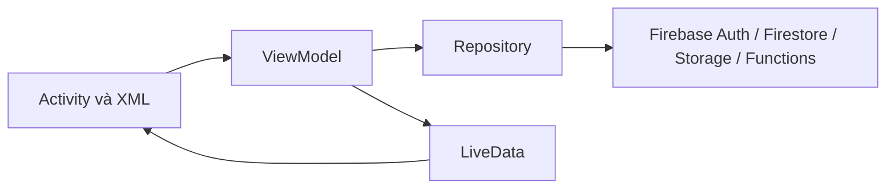

# Kiến trúc Đợt 1–2

Ứng dụng dùng Java/XML, MVVM + LiveData + Repository + Model. Không thêm DTO, DI framework, use-case layer hoặc event bus. Đợt 2 bổ sung các thao tác tin cậy qua Firebase Functions trong project Firebase hiện có.

| Phần | Trách nhiệm |
| --- | --- |
| Activity/XML | Đọc form, hiển thị lỗi, chọn ảnh, điều hướng; không gọi Firestore/Storage trực tiếp |
| `AuthViewModel` | Trạng thái đăng nhập/đăng ký, tránh gửi lặp |
| `HostViewModel` | Phòng/tòa nhà, hồ sơ Host, thống kê, thứ tự ảnh và trạng thái lưu |
| `AdminViewModel` | Nhóm duyệt đang chọn, danh sách chờ, trạng thái xử lý |
| `BookingViewModel` | Form đặt thuê, giá dự kiến từ server, key gửi lại, danh sách booking/hủy |
| `AdminEvidenceViewModel` | Tải bytes của bằng chứng riêng tư; UI xem ảnh/PDF mà không phát hành URL công khai |
| `RoomViewModel` | Phân trang, lọc trên dữ liệu đã tải, trạng thái danh sách/chi tiết công khai qua RoomRepository |
| `RoomRepository` / `RoomListing` | Đọc phòng theo schema Host, đối chiếu chủ/tòa nhà, ghép dữ liệu chỉ đọc cho UI; không ghi RoomListing vào Firestore |
| Repository | Firebase callbacks, transaction, kiểm tra UID/role và trạng thái trước ghi |
| Model | `UserProfile`, `Building`, `Room`, `HostApplication`, `Booking`, các enum; dùng luôn làm hợp đồng dữ liệu, không tạo DTO trùng nội dung |
| `HostValidation` | Giá, mode, giờ mở cửa, diện tích/sức chứa, ảnh và thông tin tòa nhà |
| `SessionActivity` | Kiểm tra đăng nhập/role khi mở màn hình; màn Host yêu cầu HOST, màn Admin yêu cầu ADMIN |

`ResultCallback<T>` dùng cho dữ liệu; `HostRepository.Callback<T>` kế thừa để giữ tương thích code cũ. Auth giữ `AuthError` riêng để thông báo lỗi đăng nhập cụ thể. UI quan sát `UiState<T>` gồm loading/data/error.

Host role được đọc lại trước thao tác repository. Server dùng transaction cho booking, duyệt role/phòng, moderation và sửa cấu hình phòng; ghi audit cùng transaction. Rules chặn client ghi trực tiếp các dữ liệu này. Không dùng UID giả, đăng nhập ẩn danh tự động hoặc role trong SharedPreferences. Không dùng timeout tự chế báo “thất bại” trong khi Firestore vẫn có thể ghi sau đó.

Ảnh được đọc/kiểm tra trên worker thread; upload tuần tự để giữ thứ tự. ViewModel giữ dữ liệu khi xoay màn hình; form phòng/tòa nhà có lưu hierarchy state. Không giữ Activity trong ViewModel.

Bám bài học: Buổi 4 (`04.2 Input controls`, inputType/EditText), Buổi 9 (`10.1 Room, LiveData, and ViewModel`, slide 42–68, 89–93), Buổi 5 (`06.1 UI testing`). Transaction bổ sung để giữ username duy nhất và duyệt trạng thái nhất quán; không thêm tầng kiến trúc ngoài phạm vi này.

Giới hạn: kiểm tra client không thay thế Rules. `firebase.json` đã chọn `firestore.secure.rules`; Functions/rules/index Đợt 2 hiện mới được kiểm thử cục bộ, chưa nghiệm thu trên Firebase thật. Xem `review-phuc-dot-2.md` và `review-hoang-dot-2.md` về phạm vi, kiểm tra và bước triển khai. Maps/chat/thông báo và các module Đợt 3 chưa mở rộng trong lượt này.
